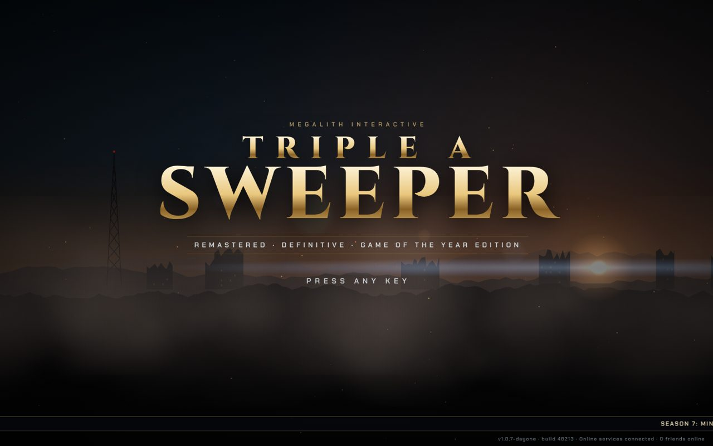
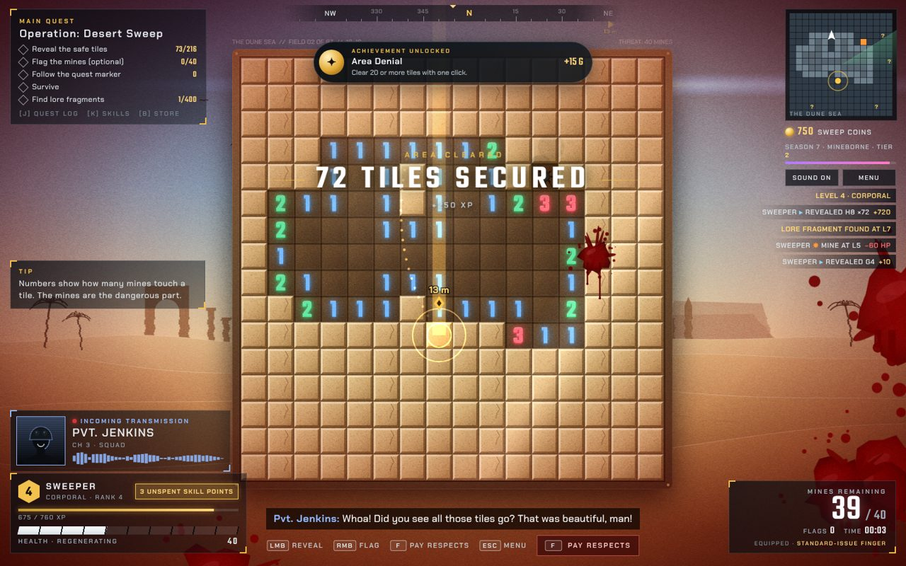
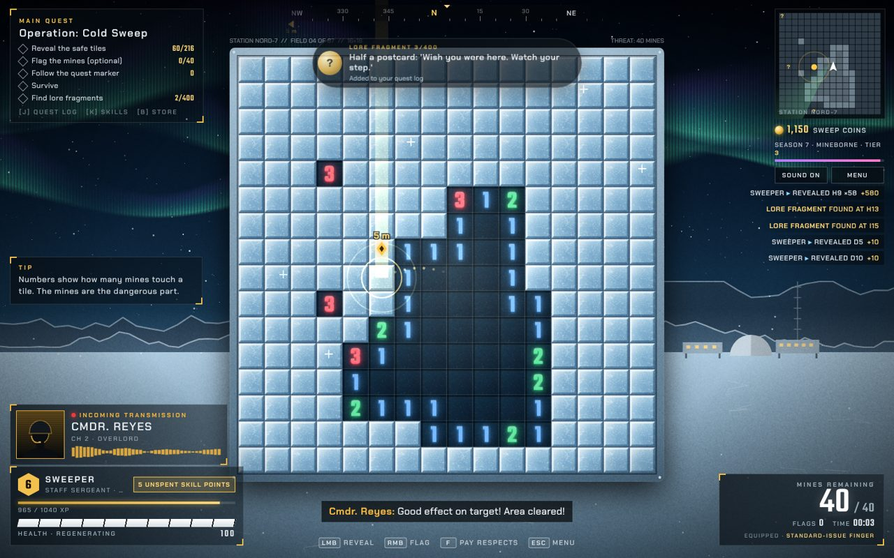
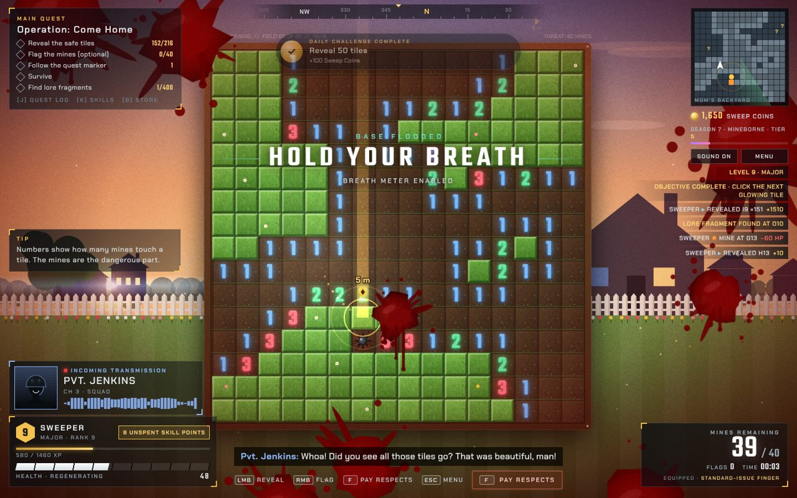
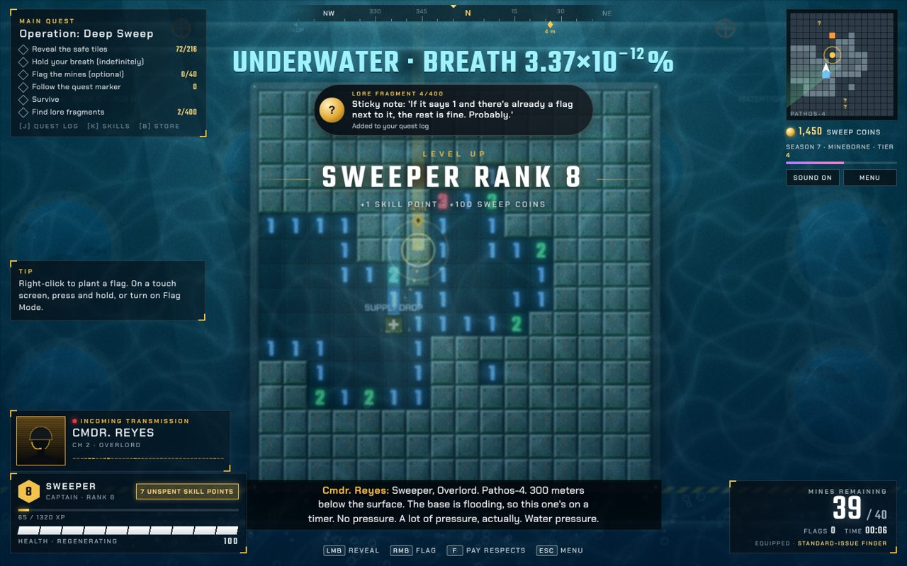

# Triple A Sweeper: game design

Triple A Sweeper is classic Minesweeper dressed up as a big-budget ("AAA") action game. The rules underneath are exactly the classic ones. Everything around them parodies blockbuster game tropes: quest markers, regenerating health, radio chatter, battle passes, loot, achievements, a launcher, middleware logos, cinematic chapters and 1,412 credits.

**The core joke:** every AAA system really works and is completely pointless. The quest marker points at a guaranteed safe tile. Health regenerates in a game where one mine is the whole challenge. The store sells flags with an identical hitbox. The joke is only funny if the game around it is genuinely good, so the minesweeper must stay fully playable and the production values must be real: procedural art, synthesised music, voiced lines.

---

## 1. Origin: the original brief

The project began as a joke, written in one prompt (quoted verbatim, typos included, because one of them became canon):

> Can you produce a web page with a working minesweepeer app for me? The catch: it's Tripple-A Minesweeper. The web page starts with a mock Win98 screen with an app icon in the middle of it. The old classic minesweeper icon, but the name says "Tripple-A Sweeper". When you click it, an intro starts: black screen, gradually fading into middlewaree logos: Unreality Engine. Mayhem Physics Engine. Blink Video. WWice. Then the screen fades in. It's a classic miesweeper, fully working, but with those tripple-a tropes everywhere and "updated" graphics. There's constently a pulsating quest marker showing you a tile that's safe to click. You get constantly bombarded by voice messages, imitating those Call of Duty ones: "Hey! I'm sorry for doubhle crossing you. When you have time, come by my office and I'll upgrade that minesweeping neural interface for you." "Yoo, Sweeper, where you bneen? Get yo ass in da club immediately!" etc. Ideally, voiced, voices generated by an AI voice synteesiser, if you're capable of that. Also, quest log, regenerating health etc. You get the idea.

## 2. How it grew

Every feature after the first version came from a short follow-up request, applied in order:

| # | Request (paraphrased, quotes verbatim) | What changed |
|---|---|---|
| 1 | The original brief above | Win98 desktop, launcher, middleware intro, title, Sector B-4, quest marker, 50 voiced lines, HUD, quest log, regenerating health, XP, store, achievements |
| 2 | "100 more voice messages · bloody screen effect when you step on a mine · an alternate soundtrack for second and third level? They can loop after that · an alternate tileset for second and third level · different backgrounds. Middle eastern desert, the club etc..." | Chapters (Dune Sea, Da Club, Station Nord-7, Mom's Backyard), scenery for every chapter, sandstone and dance-floor tilesets, desert and club music, blood overlay, 100 more lines (chapter arcs, DJ, Prof. Lindqvist, event variants) |
| 3 | "the current frequency of voice messages is too high and they are overlapping. Make the default one level lower." | Default radio chatter "Normal" with a queue, so lines never overlap |
| 4 | "'Tripple-A' is a typo. It should have been 'Triple A'" | Renamed everywhere. The typo survives as a credit under Special Thanks |
| 5 | "After the main missions finish, they will not start repeating. Instead, there will be credits. Proper AAA credits with animations and concept art showcase. Since this app is completely vibe coded, you can have your name in all the 1400 positions." | Credits: 1,412 positions, all "Claude", animated cards, procedural concept-art showcase, post-credits sting |
| 6 | "Polar base and Mom's house do not have their own themes? … Make it so. Also, unique tilesets for those levels." | Arctic and home music themes, ice and lawn tilesets |
| 7 | "one more level … The penultimate level. A flooding underwater sea base named 'Pathos-4' … timed mission … when the timer times out, there will be no game over. Instead, some character will comment that from now you have to hold your breath and there will be a blurry underwater post-process effect … unique timeset, unique music theme … pan flutes, ocarinas, heavy reverbs, lydian mode, slow tempo. Subnautica style." | Chapter 5 Pathos-4: flood countdown, underwater post-processing, breath meter, HALCYON station AI, bulkhead tileset, F Lydian theme, 27 new lines |
| 8 | "there's also some constant beeping … that clashes with the music … Just remove it." | Removed the klaxon. The final 10-second countdown ticks became unpitched clicks |
| 9 | "the breath meter should run out asymptotically. I.e. never reach zero." | Breath decays exponentially, stored as log10, so it never reaches zero (see §6) |
| 10 | "The 'Underwater - breath …' text should be about 3x as big … Also, it should run out 2x slower." | Large readout above the board, half-life 40 s |
| 11 | "That doctor from the arctic base … Generate some more, about 20 more. Used only in her level." | 20 more Prof. Lindqvist lines on Station Nord-7, shuffled per run, higher weight |
| 12 | "Can you export the music tracks?" | Offline soundtrack export (tools/ost) |
| 13 | "move it to a proper development environment" | This workspace |

Snapshots of the single-file source at each milestone are in `reference/history/` (see the README there).

---

## 3. Player journey

1. **Win98 desktop.** The page boots into a fake Windows 98 desktop ("SweepOS 98") with the classic mine icon in the middle, labelled *Triple A Sweeper*.
   - My Computer, My Documents, Recycle Bin and PATCH_NOTES.TXT open joke windows.
   - The Start menu works, and so does "Shut Down" ("It's now safe to turn off your computer").
2. **Launcher.** A Win98-style progress dialog checks for launcher updates, downloads a 74.2 GB day-one patch, compiles 48,213 shaders, installs kernel-level anti-cheat for a single-player game and signs in to Megalith Online™ (required).
3. **Intro.** Black screen, then five middleware/publisher cards, each with its own procedural audio sting:
   - **Unreality Engine 5.9**: "Reality sold separately"
   - **Mayhem Physics**: the letters drop with ragdoll physics
   - **Blink Video**: an eye that blinks
   - **WWice**: interactive audio "served at −18 °C"
   - **Megalith Interactive presents**: a monolith

   Hold Space (or press and hold) to skip.
4. **Title screen.** Gold "TRIPLE A SWEEPER — Remastered · Definitive · Game of the Year Edition", with a braam and an announcer reading the title.
   - A news ticker scrolls along the bottom, and the build string reads "0 friends online".
   - **Main menu:** New Game, Continue (requires Cloud Saves+), Store, Credits, Settings, Quit to Desktop.
5. **Difficulty.**

   | Difficulty | Board | Mines |
   |---|---|---|
   | Story | 9 × 9 | 10 |
   | Normal | 16 × 16 | 40 |
   | Veteran | 30 × 16 | 99 |
   | Realism | locked behind the Season Pass | |

6. **Chapter select.** Chapters unlock in order. The free "Time Saver Pack" (€4.99, charged €0.00) unlocks them all.
7. **Loading screen.** Fake loading messages ("Reticulating mines", "Compiling shaders (again)") and a tip.
8. **Chapter.** The chapter card fades in, the announcer reads it, and the quest giver briefs you over the radio.
9. **Results.** After each field: rank S/A/B/C (S means no mines and no deaths), stats, a 5-star rating that "has been received and ignored", NEXT CHAPTER, and a DLC upsell.
10. **Credits.** After the last chapter the credits roll instead of looping. Clearing chapter 6 rolls them; they can also be watched from the main menu.
    - Afterwards: "Play again from chapter 1".
    - Field numbers continue past 6: `FI(n)` wraps, and the chapter card says NEW GAME+.

## 4. Chapters

| # | Chapter | Operation | Scenery | Tileset | Music | Quest giver / featured voices |
|---|---|---|---|---|---|---|
| 1 | **Sector B-4** | Clean Sweep | Dusk battlefield: ruined skyline, radio tower, smoke, embers, fog, sun flare | Brushed steel plates | `game`: D minor, 100 BPM, pluck ostinato, taiko, braams | Cmdr. Reyes; Kova and Big Dez lead the chatter |
| 2 | **The Dune Sea** | Desert Sweep | Dunes, stone arch gate, palms, heat haze, vultures | Sandstone | `desert`: D Hijaz oud, darbuka, drones, ney | Reyes, Jenkins |
| 3 | **Da Club** | Get In Da Club | Neon VIP / DA CLUB signs, DJ booth, beat-synced lights | Dance floor (glows to the beat) | `club`: A minor house, 124 BPM | Big Dez, DJ Detonator over the PA |
| 4 | **Station Nord-7** | Cold Sweep | Arctic night, aurora, station domes and mast, snow | Ice (frost glints) | `arctic`: E minor bells, 66 BPM | Prof. Lindqvist (24 lines) |
| 5 | **Pathos-4** | Deep Sweep | Flooding sea base, Deck C: portholes with fish, pipes, valves, hazard stripes, alarm lights, rising water | Corroded bulkheads, flooded grating | `pathos`: F Lydian, 62 BPM, pan flute, ocarina, harp, 6.5 s reverb, whale calls | Reyes, HALCYON (station AI) |
| 6 | **Mom's Backyard** | Come Home | Suburban sunset, house, fence, TV, garden gnome, tulips | Striped lawn with flowers | `home`: swung e-piano and whistle, 88 BPM | Mom |

**Da Club also comes to you.** If Big Dez's last line (`d_5`: "If you won't come to the club, the club is coming to you!") plays in another chapter, "THE CLUB HAS ARRIVED" for 24 seconds: club music, dance-floor lighting and +500 XP.

## 5. Rules and systems

### Minesweeper core (classic, untouched)
- **Rules:** left click reveals and right click flags. On touch, long-press flags; there is also a Flag Mode button. The keyboard works too: arrows or WASD move, Space/Enter reveals, X/Q flags.
- **First click:** always safe, and so are its 8 neighbours (mines are planted after the first click).
- **Zeros:** a zero opens its neighbours with a flood fill. The reveal animates outward ring by ring.
- **Chording:** clicking a number whose flags match its count opens the rest.
- **Win:** reveal every safe tile. Flags are not required.

### The AAA layer
- **Quest marker:** a pulsating beam, ring and arrow over a tile that is guaranteed safe.
  - The game prefers hidden safe tiles next to revealed ones, nearest to your last click.
  - It also appears on the compass and minimap and leaves a dotted trail.
  - Following it counts "objectives complete". Ignoring it unlocks *Independent Thinker*.
  - The *Bigger Marker* perk makes it 50 % larger.
- **Health and damage** (every number here is in `TUNING`, `js/data/tuning.js`):
  - A mine deals 60 HP (45 with *Thick Skin*).
  - Health regenerates at 24 HP/s after 3 s without damage (1.5 s with *Second Wind*).
  - Below 40 HP: heartbeat, desaturated screen and a "Health critical" warning.
  - Each hit adds blood splats, drips, a hit-direction arc, camera shake and a shellshock muffle with tinnitus. Blood can be turned off.
- **Death is not game over.** "MISSION FAILED" shows a fake quote and loads the last checkpoint, which keeps all progress "because we respect your time". Respawn tokens: ∞ (Premium).
- **XP and levels:**
  - XP for every reveal (10 per tile), chords, flags, following the marker, lore and big reveals.
  - Each level needs `200 + 140 × level` XP and gives +1 skill point and +100 Sweep Coins.
  - Ranks run from RECRUIT to SWEEPLORD.
  - The season pass tier bar fills purely for decoration.
- **Skills (perks):** Thick Skin, Second Wind, Mine Scholar (+25 % XP), Bigger Marker, Lucky Find (supply drops twice as often). An "Unspent skill point" nag is shown and voiced.
- **Store:**
  - Golden, Chrome and Musical flag skins (the Musical Flag plays a tune you cannot turn off).
  - XP Booster ×2 for 5 minutes.
  - Supply Crate, with loot odds "disclosed on request. Do not request."
  - A €9.99 real-money coin bundle that cannot be bought.
- **Supply drops:** a crate lands on a revealed tile every ~60 s (marked on the minimap). Click it for coins and a loot roll from Common to Legendary, e.g. "Golden Shovel (cosmetic, invisible)". Ignore it for 38 s and "another player" loots it.
- **Lore fragments:** 3–6 hidden under safe tiles per field (collected when revealed).
  - The counter says "x/400", but there are 13 actual texts, which cycle.
  - Each one is a toast, gives +50 XP and is voiced by Jenkins or Reyes.
- **Achievements:** 27 in total, each with Gamerscore (`ACHIEVEMENTS` in `js/data/achievements.js`). Examples: First Click, Area Denial (20+ tiles at once), Paying Respects (press F), Patience Is a Virtue (do nothing for 20 s), Credits Enjoyer, Ungrateful (skip the credits, 0 G), Dry Run and Breathtaking (Pathos-4).
- **Side quests:** the radio adds them to the quest log. Neural Interface Upgrade (Kova), Get Yo Ass In Da Club (Dez), Call Your Mother, Premium Flag Collector, Whispers in the Field, Ice Core Samples ("Not implemented"), Dinner Is Ready, Rate Your Stay (HALCYON). Each one has a fake compass bearing and distance.
- **Kill feed and combos:**
  - The right-side feed logs every action ("SWEEPER ▸ REVEALED H10 ×146 +1460").
  - Multi-reveals get combo titles: DOUBLE REVEAL, MULTI-REVEAL, MEGA SWEEP, SWEEPTACULAR, SWEEPOCALYPSE.
  - 20+ tiles at once triggers an "AREA CLEARED" banner.
- **Constant interruptions:**
  - Tips with brackets ("[J] Quest log").
  - An autosave spinner ("DO NOT TURN OFF YOUR COMPUTER").
  - A daily challenge (reveal 50 tiles).
  - "Limited time offer" pop-ups after the Quartermaster speaks.
  - Idle nags after 13 s.
  - Press F to pay respects after stepping on a mine.
- **Pause menu:** "The game is not paused online."
- **Settings:**
  - Real settings: master, music, voice and effects volume, radio chatter (Off / Normal / Constant / Unbearable), subtitles, film grain, camera sway, blood.
  - Locked settings: Motion blur "Cinematic (mandatory)", "Path-traced tiles" and Upscaling "Ultra Performance (renders at 9 × 9)".

## 6. Pathos-4 (chapter 5) in detail

- **Countdown:** "FLOODING IN mm:ss" sits in a large readout above the board, and a water gauge fills on the right.
  - The timer is 1:30 on Story, 3:30 on Normal and 7:00 on Veteran. It starts 3 s into the chapter.
  - Behind the board, the water rises and red alarm lights pulse.
- **Warnings:**
  - At 12 s, HALCYON announces a hull breach.
  - At 30 s left, "FLOODING IMMINENT · 30 SECONDS · Take a deep breath" plus Reyes ("Take a big one").
  - The last 10 seconds tick with unpitched clicks. The original pitched klaxon clashed with the Lydian score and was removed.
- **When it floods there is no game over.** Reyes: "From now on, you'll have to hold your breath. Command believes in you. Command is on dry land." HALCYON follows up 10 s later.
  - **Underwater look:**
    - teal blur on the board canvas (CSS filter) and a water overlay
    - animated caustics and slanted light shafts
    - rising bubbles and a slower, larger camera drift
  - **Muffled sound:** all audio goes through a 1.2 kHz low-pass.
  - **Lines after the flood:** Jenkins, Mom and Reyes have lines that only play now.
- **Breath meter:** starts at 100 % and halves every 40 s, forever. Internally it is `bLog = log10(percent)` decreasing linearly, so it never underflows.
  - At or above 10 % it shows whole numbers (100 → 50 after 40 s → 12 after 2 min).
  - Below that it shows three significant digits (0.996 % at ~4½ min).
  - After about 18 minutes it switches to scientific notation with a raised exponent (3.37×10⁻¹² %).
- **Achievements:** *Dry Run* (clear it before the flood), *Breathtaking* (clear it while holding your breath), *Pressure Test* (clear it at all).

## 7. Cast

All voices are synthesised with Kokoro TTS (see [VOICES.md](VOICES.md)). Radio voices go through a radio filter, with squelch and a portrait in the transmission panel.

| Key | Name | Role | Kokoro voice |
|---|---|---|---|
| `reyes` | Cmdr. Reyes, "Overlord" | Gruff commanding officer, quest giver | `am_onyx` |
| `kova` | Dr. Mirela Kova | Neurotech Labs; double-crossed you, sorry (not sorry), subscription upsells | `af_bella` |
| `dez` | Big Dez | Owner of Da Club. Get yo ass in da club | `am_puck` ×1.12 |
| `dj` | DJ Detonator | PA system in Da Club (echo) | `am_michael` ×1.12 |
| `qm` | Quartermaster Pryce | Sells flags | `bm_george` ×1.05 |
| `mom` | Mom | Phone calls (phone filter) | `af_heart` |
| `jenkins` | Pvt. Jenkins | Over-eager squadmate, helmet two sizes too big | `am_liam` ×1.15 |
| `whisper` | ??? | Encrypted, eerie (echo), "the field is clearing you" | `bm_lewis` ×0.8 |
| `prof` | Prof. Lindqvist | Station Nord-7 glaciologist, deadpan | `bf_alice` ×0.98 |
| `halcyon` | HALCYON | Pathos-4 station AI, relentlessly cheerful (PA echo) | `af_sky` ×0.92 |
| `sys` | SYSTEM | Achievement / autosave / level-up announcements | `af_nova` ×0.95 |
| `announcer` | (trailer voice) | Title and chapter names, no subtitles | `am_fenrir` ×0.82 |

There are 197 lines in total. Chatter rules: each chapter has its own arcs per character plus a shared pool and repeats. See [AUDIO.md](AUDIO.md#5-radio-chatter-manager).

## 8. Credits

- **Size:** 1,412 positions across 16 departments and 14 "Megalith" studios worldwide, filled out with QA testers. Every name is "Claude".
- **Running gags:** "Director of Quest Marker Brightness", "Jira Archaeologist", "Pronunciation Coach ('Nord Seven')", "Payroll (Unpaid)", "Production Babies: Opus · Sonnet · Haiku".
- **Concept-art showcase:** cross-fading procedural "concept art" sheets beside the roll, with handwritten notes ("tower = iconic", "fish = free content"). There are key art sheets per chapter, a cast sheet, a mine model sheet, a quest-marker sheet and a tile material study.
- **Controls:** hold Space (or press and hold) to fast-forward. Skipping unlocks *Ungrateful*.
- **Ending:** post-credits cards ("SWEEPER WILL RETURN IN · TRIPLE A SWEEPER 2"), then the campaign results screen.

## 9. Tone and writing rules

- Deadpan. The game never winks too hard: systems are presented with total sincerity ("The quest marker marks the quest.").
- Every joke is attached to a real, working feature or a real AAA trope. Avoid random humour.
- Voice lines are short (2–10 s), radio-style, and usually make one joke. Characters keep their voice:
  - Kova always upsells.
  - Dez only cares about the club.
  - Mom worries.
  - Jenkins is earnest and useless.
  - The whisper is ominous about numbers.
  - Lindqvist is a dry scientist.
  - HALCYON is a customer-satisfaction AI.
- No real brands, games or people are named. Middleware names are invented parodies.
- Minesweeper itself is never compromised. Nothing may make the puzzle unfair or block clicks for long. Banners and toasts are transient.

## 10. Known gaps and ideas

- **Unfinished on purpose:** side quests such as Ice Core Samples and Rate Your Stay say "Not implemented". The joke depends on that.
- **Lore:** the "/400" counter is a joke too; there are 13 texts.
- **Missing features:** there is no real save/continue of a field in progress. Only the profile (XP, coins, perks, achievements, unlocked chapters) and settings persist.
- **Mobile:** works (touch, long-press flags, narrow layout), but Veteran is unpleasant on a phone.
- **Possible directions:**
  - more chapters (each needs scenery, a tileset, music, chatter arcs; see ARCHITECTURE.md)
  - localisation
  - a "director's commentary" mode
  - real saving
