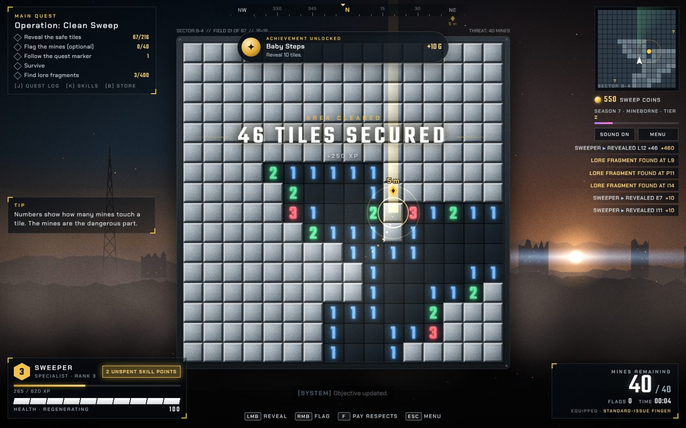

# Chapter 1: Sector B-4

| | |
|---|---|
| Chapter id | `battle` |
| Card | CHAPTER ONE · Operation: Clean Sweep · 06:42 LOCAL |
| Quest giver | Cmdr. Reyes |
| Card text | "Command has ordered you to clear Sector B-4 before the season ends. The season ends in 3 days, 14 hours. A glowing marker will tell you where to click, so you never have to think." |
| Scenery | `BattlefieldScenery` (also the title screen backdrop) |
| Tileset | `SteelTileset` (also the fallback look) |
| Music | `game` (`battle-theme.js`) |
| Achievement | *Clean Sweep* (`win`, any cleared field); there is no chapter-specific one |

## 1. Original prompt

Sector B-4 is the whole of the first version: the original one-prompt brief (GAME_DESIGN.md §1, verbatim, typos included).

> Can you produce a web page with a working minesweepeer app for me? The catch: it's Tripple-A Minesweeper. The web page starts with a mock Win98 screen with an app icon in the middle of it. The old classic minesweeper icon, but the name says "Tripple-A Sweeper". When you click it, an intro starts: black screen, gradually fading into middlewaree logos: Unreality Engine. Mayhem Physics Engine. Blink Video. WWice. Then the screen fades in. It's a classic miesweeper, fully working, but with those tripple-a tropes everywhere and "updated" graphics. There's constently a pulsating quest marker showing you a tile that's safe to click. You get constantly bombarded by voice messages, imitating those Call of Duty ones: "Hey! I'm sorry for doubhle crossing you. When you have time, come by my office and I'll upgrade that minesweeping neural interface for you." "Yoo, Sweeper, where you bneen? Get yo ass in da club immediately!" etc. Ideally, voiced, voices generated by an AI voice synteesiser, if you're capable of that. Also, quest log, regenerating health etc. You get the idea.

The two example lines in the brief became `k_1` (Dr. Kova) and `d_1` (Big Dez), and they are still the chapter's opening chatter.

## 2. Artistic intention

The generic military shooter opening: the chapter that establishes every trope the rest of the game riffs on.

- **Scenery:** a burning city at dusk. Ruins against an orange sky, a blinking radio tower, rolling fog, smoke, embers drifting up and a sun flare. The concept-art notes in the credits: "more fog?", "sun too nice", "tower = iconic".
- **Tileset:** brushed steel plates with a soft highlight and rivets once the tiles are big enough. Military hardware, nothing more.
- **Music:** `game`, D minor at 100 BPM. A driving pluck ostinato over pads and taiko, with a trailer braam on every other 4-bar cycle (MUSIC.md §3).
- **Tone:** sincere blockbuster briefing. The joke is the gap between the drama ("nobody else has to die") and the activity (clicking a glowing tile).

## 3. Special mechanics

None beyond the core AAA layer, which every chapter has. Sector B-4 is where the player first meets all of it: quest marker, regenerating health, XP, supply drops, lore, side quests.

**The club comes to you.** Big Dez's arc here ends with `d_5`. If it plays in any chapter other than Da Club, "THE CLUB HAS ARRIVED" for 24 seconds: club music, dance-floor lighting, +500 XP and the *Club Kid* achievement. Sector B-4 is the only chapter where Dez has a five-line arc, so this is where it normally happens.

## 4. Cast and unique voice lines

Announcer: `a_ch1` "Chapter One. Sector B-4."
Opening line: `r_start` (Reyes). Chatter opens with `k_1`, `d_1`. Favourite speakers: Big Dez and Dr. Kova.

### [Cmdr. Reyes](../characters/reyes.md)

| Id | Line |
|---|---|
| `r_start` | Sweeper, this is Overlord. The field is hot. Follow the marker, and nobody else has to die. |
| `r_copy` | Sweeper, do you copy? Click the glowing tile. The one with the big arrow over it. |
| `r_intel` | Intel says this field is full of mines. That's why they call it a minefield. |
| `r_push` | Keep pushing, Sweeper! Those tiles won't reveal themselves! |
| `r_win` | Field is clear! Outstanding work, Sweeper. Now get back to base. We've got another field. And forty more after that. *(victory)* |

### [Dr. Mirela Kova](../characters/kova.md)

| Id | Line |
|---|---|
| `k_1` | Hey! I'm sorry for double-crossing you. When you have time, come by my office and I'll upgrade that minesweeping neural interface for you. *(quest: Neural Interface Upgrade)* |
| `k_2` | Sweeper, it's Mirela. I know you're still mad. The upgrade offer stands. No strings attached. Mostly. |
| `k_3` | Okay, full disclosure. The neural interface upgrade has a small subscription fee. 9.99 a month. |
| `k_4` | I may have also planted some of these mines. In my defense, it was a very confusing week. |
| `k_5` | The upgrade is ready. It shows you which tiles are safe. Oh. You already have that. Never mind. |

### [Big Dez](../characters/dez.md)

| Id | Line |
|---|---|
| `d_1` | Yoo, Sweeper, where you been? Get yo ass in da club immediately! *(quest: Get Yo Ass In Da Club)* |
| `d_2` | Sweeper! The club is open, the DJ is waiting, and you're out there clicking squares? Come on, man! |
| `d_3` | Bro. I put you on the guest list three times. Three times! The bouncer thinks you're a myth. |
| `d_4` | Okay. I'm not mad. I'm just saying. The club is very sad without you. |
| `d_5` | That's it. If you won't come to the club, the club is coming to you! Drop it! *(starts the club night)* |
| `d_win` | Yo, you done? You done? Club. Now. I'm sending a car. *(second victory line, on the results screen)* |

### [Mom](../characters/mom.md)

| Id | Line |
|---|---|
| `m_1` | Hi sweetie, it's Mom. I don't really understand your job, but please don't step on anything. *(quest: Call Your Mother)* |
| `m_2` | Your cousin's wedding is on Saturday, and you still haven't answered the invitation. Also, are you eating? |
| `m_3` | Your father wants to know if minesweeping comes with a pension plan. |

### [Quartermaster Pryce](../characters/quartermaster-pryce.md)

| Id | Line |
|---|---|
| `q_1` | Sweeper, Quartermaster here. New flag skins have just arrived. Gold, chrome, and one that plays a little tune. *(quest: Premium Flag Collector)* |
| `q_2` | A reminder that your premium battle pass expires in four hours. No pressure. Some pressure. |
| `q_3` | Those mines won't flag themselves. Unless you buy the auto-flag bundle. 12.99. |
| `q_4` | Limited time offer, Sweeper. Buy one flag, get one flag. That's two flags. |

### [Pvt. Jenkins](../characters/jenkins.md)

| Id | Line |
|---|---|
| `j_2` | I've marked the safe tile on your HUD. And on your compass. And on the minimap. And in the sky. |
| `j_3` | I'll hold this position! ...I'm just gonna stand here, actually. Holding. |
| `j_4` | Follow me, Sweeper! Actually, you follow the marker. I'll follow you. |

### [??? (the whisper)](../characters/whisper.md)

| Id | Line |
|---|---|
| `w_1` | The mines were here before us, Sweeper. They will be here after. *(quest: Whispers in the Field)* |
| `w_2` | Every number tells a story. Most of those stories are about mines. |
| `w_3` | You think you're clearing the field. But the field is clearing you. |

Most of these lines are also in `REPEATABLE_LINES`, so they come back in every chapter once its own lines have run out.
