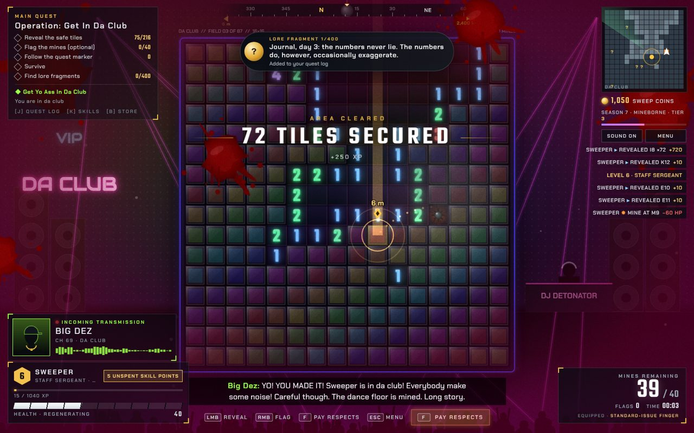

# Chapter 3: Da Club

| | |
|---|---|
| Chapter id | `club` (`isClub: true`, screen class `is-club-chapter`) |
| Card | CHAPTER THREE · Operation: Get In Da Club · 01:30 LOCAL · 124 BPM |
| Quest giver | Big Dez |
| Card text | "You are finally in da club. The dance floor is mined. Big Dez would like it cleared before the drop." |
| Scenery | `ClubScenery` |
| Tileset | `DanceFloorTileset` |
| Music | `club` (`club-theme.js`) |
| Achievement | *VIP* (`ch3`) |

## 1. Original prompt

Da Club pays off a line from the original brief, "Yoo, Sweeper, where you bneen? Get yo ass in da club immediately!" (GAME_DESIGN.md §1). It was built in request 2 (§2, excerpt as quoted there):

> "100 more voice messages · bloody screen effect when you step on a mine · an alternate soundtrack for second and third level? They can loop after that · an alternate tileset for second and third level · different backgrounds. Middle eastern desert, the club etc..."

## 2. Artistic intention

The running gag of chapter 1 becomes a level: after two chapters of Big Dez begging, the player is finally in da club, and the dance floor is mined. It is the one chapter where the quest giver isn't military.

- **Scenery:** a nightclub where everything moves to the 124 BPM music. Lights and lasers on the beat, a mirror ball, neon VIP / DA CLUB signs, the DJ booth and a dancing crowd; every 16th beat the whole room flashes. Concept-art notes: "MORE LASERS", "Dez wants bigger sign", "bouncer cut for budget". The bouncer who "thinks you're a myth" (`d_3`) never appears.
- **Tileset:** dark glossy glass dance-floor tiles. The coloured lights are drawn live on top, pulsing to the beat, and the board frame gets neon edges.
- **Music:** `club`, A minor house at 124 BPM. Four-on-the-floor kick, clap, hats, off-beat saw bass, chord stabs; an arpeggio joins for the second half of each 8-bar cycle and a riser ends it (MUSIC.md §3).
- **Tone:** a party that refuses to acknowledge the danger. Reyes calls in confused, Mom shows up on the guest list, Jenkins discovers he is better at dancing than at soldiering.

## 3. Special mechanics

- **The board dances:** the dance-floor lights on the tiles and the scenery (lights, crowd, DJ) pulse at a fixed 124 BPM, the tempo of the club theme, so the board itself moves to the music.
- **Second voice on the PA:** DJ Detonator speaks over the club PA (short echo) rather than the radio. He shares the favourite weight with Dez.
- **The side quest completes itself:** "Get Yo Ass In Da Club" shows "You are in da club" here. Dez hands out no new quest in this chapter.
- **Club night elsewhere:** the same music and lighting visit other chapters for 24 s when Dez's `d_5` plays (see [Sector B-4](1-sector-b4.md#3-special-mechanics)).

## 4. Cast and unique voice lines

Announcer: `a_ch3` "Chapter three. Da Club."
Opening line: `dc_start` (Dez). Chatter opens with `dj_1`, `mc_1`. Favourite speakers: Big Dez and DJ Detonator.

### [Big Dez](../characters/dez.md)

| Id | Line |
|---|---|
| `dc_start` | YO! YOU MADE IT! Sweeper is in da club! Everybody make some noise! Careful though. The dance floor is mined. Long story. |
| `dc_1` | Bro, this is the best night of my life. Also, don't step on the third tile from the bar. Trust me. |
| `dc_2` | You see that? The whole club is watching you sweep. They think it's a dance. Lean into it. |
| `dc_3` | The bouncer says sorry for not believing you exist. He's been crying. Big guy, big feelings. |
| `dc_4` | Okay, real talk. Who mined the dance floor? I'm not mad. I'm just asking. Dr. Kova, was it you? |
| `dc_win` | Floor's clear! Sweeper, you're a legend! VIP for life! The drinks are on Overlord! *(victory)* |

### [DJ Detonator](../characters/dj-detonator.md)

| Id | Line |
|---|---|
| `dj_1` | This one goes out to Sweeper, clicking tiles in the middle of the dance floor! Respect! |
| `dj_2` | Put your hands up! But not on the tiles! Seriously, keep your hands off the tiles! |
| `dj_3` | Request from table six: less explosions. Request denied! |
| `dj_5` | Shout out to Mom, who is apparently on the guest list. Hi, Mom! |
| `dj_4` | We're gonna slow it down now. Just kidding. We never slow it down. *(second victory line, on the results screen)* |

### [Cmdr. Reyes](../characters/reyes.md)

| Id | Line |
|---|---|
| `rc_1` | Sweeper, Overlord. Our intel says you are in a nightclub. Is that correct? Are you on a mission, or on a night out? |
| `rc_2` | Sweeper, the music on your channel is very loud. Please confirm the mines are still the priority. Also, what's this song? |

### [Dr. Mirela Kova](../characters/kova.md)

| Id | Line |
|---|---|
| `kc_1` | So, funny story. I may have mined the dance floor. I was aiming for the parking lot. Spatial reasoning is not my area. *(quest: Neural Interface Upgrade)* |
| `kc_2` | The neural interface has a party mode now. It makes the quest marker dance. 9.99. |

### [Pvt. Jenkins](../characters/jenkins.md)

| Id | Line |
|---|---|
| `jc_1` | Sweeper, I've been dancing for an hour. I think I'm better at this than at soldiering. |
| `jc_2` | A guy asked me if I'm a real soldier. I said I'm a squad member. He said, cool hat. |

### [Mom](../characters/mom.md)

| Id | Line |
|---|---|
| `mc_1` | Honey, are you at a club? It sounds like a club. Are you safe? Are you making friends? *(quest: Call Your Mother)* |
| `mc_2` | I'm here! Dez put me on the list. The music is very loud, and nobody here eats vegetables. |

### [Quartermaster Pryce](../characters/quartermaster-pryce.md)

| Id | Line |
|---|---|
| `qc_1` | Quartermaster here. Club exclusive glow-in-the-dark flags are available behind the bar. Cash only. *(quest: Premium Flag Collector)* |

### [??? (the whisper)](../characters/whisper.md)

| Id | Line |
|---|---|
| `wc_1` | Even here, Sweeper. Even beneath the music. The mines are listening to the bass. *(quest: Whispers in the Field)* |
