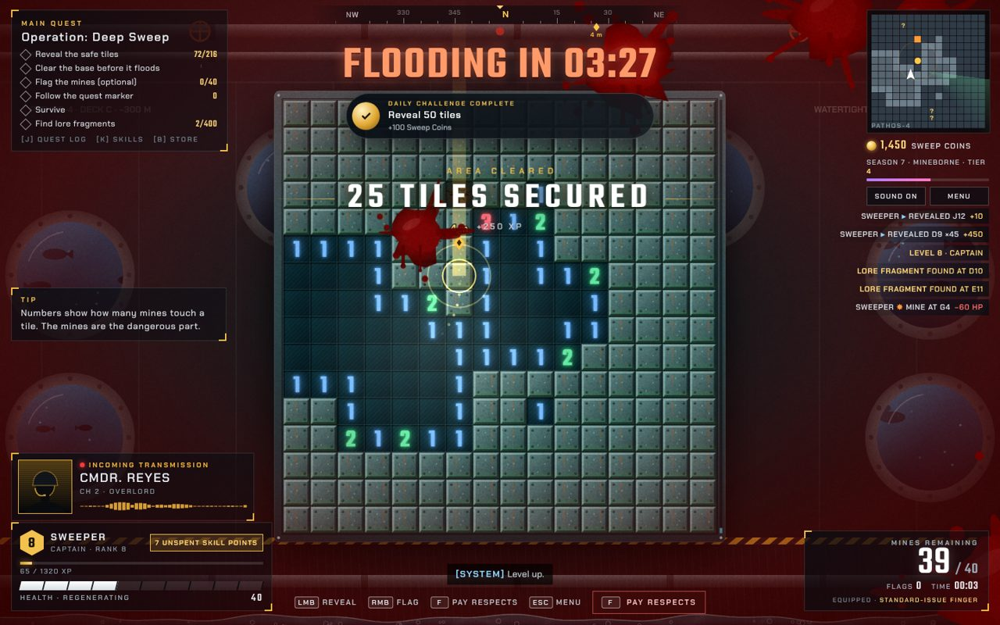

# Chapter 5: Pathos-4

| | |
|---|---|
| Chapter id | `pathos` (`floods: true`, screen class `is-pathos-chapter`) |
| Card | CHAPTER FIVE · Operation: Deep Sweep · −300 M · HULL INTEGRITY 40% |
| Quest giver | Cmdr. Reyes |
| Card text | "An underwater research base is flooding, and it is full of mines. Clear it before the water reaches the ceiling. Or after. Command is not your mother." |
| Scenery | `PathosScenery` |
| Tileset | `BulkheadTileset` |
| Music | `pathos` (`pathos-theme.js`) |
| Achievements | *Pressure Test* (`chP`, clear it), *Dry Run* (`dryrun`, clear it before the flood), *Breathtaking* (`breath`, clear it while holding your breath) |

## 1. Original prompt

Pathos-4 was the last chapter added, inserted as the penultimate level. Request 7 created it (GAME_DESIGN.md §2, excerpt as quoted there):

> "one more level … The penultimate level. A flooding underwater sea base named 'Pathos-4' … timed mission … when the timer times out, there will be no game over. Instead, some character will comment that from now you have to hold your breath and there will be a blurry underwater post-process effect … unique timeset, unique music theme … pan flutes, ocarinas, heavy reverbs, lydian mode, slow tempo. Subnautica style."

Three follow-ups tuned it:

- Request 8: "there's also some constant beeping … that clashes with the music … Just remove it." (the klaxon went; the last ten seconds now tick with unpitched clicks)
- Request 9: "the breath meter should run out asymptotically. I.e. never reach zero."
- Request 10: "The 'Underwater - breath …' text should be about 3x as big … Also, it should run out 2x slower."

## 2. Artistic intention

The underwater-horror level of a blockbuster, turned serene. The timed mission builds tension, and when it runs out nothing bad happens: the game simply goes on under water, looking and sounding beautiful, while the breath readout needs ever more decimals.

- **Scenery:** Deck C of a flooding sea base. Portholes with fish swimming past, pipes, valves, hazard stripes, red alarm lights, leaks, and a water level that follows the flood countdown. Concept-art notes: "wetter", "fish = free content", "water level: rising (good)".
- **Tileset:** corroded bulkheads: teal painted steel with rust streaks, algae along the bottom, rivets and condensation. Opened tiles are flooded grating.
- **Music:** `pathos`, F Lydian at 62 BPM. Harp arpeggios as the steady water motion, pan flute and ocarina trading the melody on alternate phrases, a slow water swell, a whale-like call every fourth phrase, all in a 6.5 s reverb. The G major chord puts B natural against the F tonic, the Lydian ♯4 (MUSIC.md §4).
- **Underwater look:** after the flood, a teal blur on the board canvas and a water overlay, animated caustics, slanted light shafts, rising bubbles and a slower, larger camera drift. All audio goes through a 1.2 kHz low-pass.
- **Tone:** HALCYON, the station AI, treats a catastrophe as a customer-service interaction. Reyes is supportive from dry land.
- **Sound rule:** pitched effects must not clash with the Lydian score. The klaxon was removed for that reason, so prefer unpitched sounds here.

## 3. Special mechanics

All numbers are in `TUNING.flood` (`js/data/tuning.js`); the logic is in `js/game/flood-controller.js`. Details in GAME_DESIGN.md §6.

- **Countdown:** "FLOODING IN mm:ss" above the board and a water gauge on the right. 1:30 on Story, 3:30 on Normal, 7:00 on Veteran, starting 3 s into the chapter.
- **On the way:** the SYSTEM voice announces a hull breach 12 s in (`s_breach`). At 30 s left, "FLOODING IMMINENT" (`s_flood`) and Reyes (`rp_2`); bubbles start rising. The last 10 s tick with unpitched clicks.
- **The flood is not a game over.** "BASE FLOODED · HOLD YOUR BREATH". Reyes (`rp_flood`) at 1.6 s, HALCYON (`hc_flood`) at 10 s. The flood-only lines `rp_3`, `jp_3`, `mp_2` are queued at the front of the chatter, after 14 s of quiet.
- **Breath meter:** starts at 100 % and halves every 40 s, forever. Stored as `log10(percent)`, so it never reaches zero; the readout switches to more digits and finally to scientific notation.

## 4. Cast and unique voice lines

Announcer: `a_ch5p` "Chapter Five. Pathos-4."
Opening line: `rp_start` (Reyes). Chatter opens with `hc_1`, `jp_1`. Favourite speakers: HALCYON and Reyes.

### [HALCYON](../characters/halcyon.md)

| Id | Line |
|---|---|
| `hc_1` | Welcome to Pathos-4. Hull integrity is at 40%. Please enjoy your stay. *(quest: Rate Your Stay)* |
| `hc_2` | Reminder. The emergency exits are also flooded. |
| `hc_3` | This station is rated for 300 meters. We are currently at 301 meters. |
| `hc_flood` | Flooding complete. Thank you for your patience. Oxygen is now a matter of personal preference. *(10 s after the flood)* |
| `hc_win` | Thank you for visiting Pathos-4. Please rate your stay. Five stars is the only option. *(second victory line, on the results screen)* |

### [Cmdr. Reyes](../characters/reyes.md)

| Id | Line |
|---|---|
| `rp_start` | Sweeper, Overlord. Pathos-4. 300 meters below the surface. The base is flooding, so this one's on a timer. No pressure. A lot of pressure, actually. Water pressure. |
| `rp_1` | Sweeper, the water is rising. Click faster. Or click at the same speed, but with more urgency. |
| `rp_2` | Thirty seconds, Sweeper! Take a deep breath. Seriously. Take a big one. *(30 s warning)* |
| `rp_flood` | Sweeper, the base is fully flooded. From now on, you'll have to hold your breath. Command believes in you. Command is on dry land. *(the flood)* |
| `rp_3` | Status report. You are underwater. The mines are underwater. Everything is underwater. Carry on. *(after the flood)* |
| `rp_win` | Pathos sector cleared! Get to the surface, Sweeper. Decompress slowly. Then report to your mother's house. *(victory)* |

### [Pvt. Jenkins](../characters/jenkins.md)

| Id | Line |
|---|---|
| `jp_1` | Sweeper, there's water in my helmet. Is that normal? Tell me that's normal. |
| `jp_2` | I saw a fish out the window. It had a quest marker. |
| `jp_3` | I've been holding my breath for two minutes. I think I'm getting really good at this. *(after the flood)* |

### [Dr. Mirela Kova](../characters/kova.md)

| Id | Line |
|---|---|
| `kp_1` | Mirela here. Good news. The neural interface is waterproof. Well, water resistant. It's damp tolerant. *(quest: Neural Interface Upgrade)* |
| `kp_2` | Small confession. I designed this base. The leak is a feature. It's called immersion. |

### [Big Dez](../characters/dez.md)

| Id | Line |
|---|---|
| `dp_1` | Sweeper! You're underwater? Bro! Underwater rave. Next weekend. Bring the fish. *(quest: Get Yo Ass In Da Club)* |

### [Mom](../characters/mom.md)

| Id | Line |
|---|---|
| `mp_1` | Sweetie, are you near water? You know you can't swim very well. Remember the lake? *(quest: Call Your Mother)* |
| `mp_2` | Your voice sounds bubbly. Are you holding your breath? Breathe, honey. Breathe. *(after the flood)* |

### [Quartermaster Pryce](../characters/quartermaster-pryce.md)

| Id | Line |
|---|---|
| `qp_1` | Quartermaster here. Waterproof flags now in stock. They also float, which makes them terrible flags. *(quest: Premium Flag Collector)* |

### [??? (the whisper)](../characters/whisper.md)

| Id | Line |
|---|---|
| `wp_1` | Down here, Sweeper, the mines dream of the surface. *(quest: Whispers in the Field)* |
| `wp_2` | The deep keeps every secret. Except the quest marker. The marker tells everyone. |

### [SYSTEM](../characters/system.md)

| Id | Line |
|---|---|
| `s_breach` | Warning. Hull breach detected. *(12 s into the countdown)* |
| `s_flood` | Flooding imminent. *(30 s left)* |
